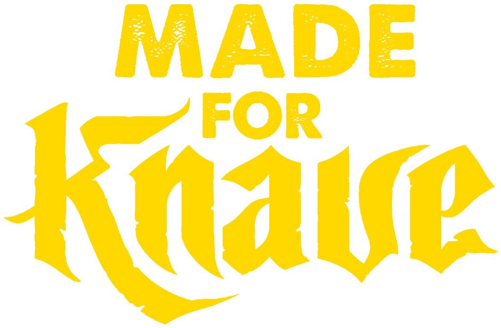

<!-- welcome:start (generated by `npm run build:readme` from lang/en.json and module/welcome-data.js: edit those, not this) -->
<h1 align="center"><picture><source media="(prefers-color-scheme: dark)" srcset="art/welcome/portraits/femme-white.png"></picture> Base Knavery™ <picture><source media="(prefers-color-scheme: dark)" srcset="art/welcome/portraits/knight-white.png"></picture></h1>
<p align="center">by <a href="https://github.com/domfortunato">Dom Bosco</a></p>

<p align="center">Base Knavery is an unofficial, fan-made Foundry VTT system for Knave, first and second editions.<br>Questing Beast LLC did not make it and has not endorsed it.</p>

## System Rules

- **Knave is built in.** A new world plays Ben Milton's original Knave as written. Its rules, tables and spells come with the system.
- **Knave 2e relies on your purchased copy of the book.** Upload your Knave 2e PDF and build its tables, and you'll be offered a switch to 2e rules. Characters you already have don't change.
- **Mix them.** Each rule has its own switch in Game Settings, under Configure Rules.

## Buy the books!

Both editions of Knave were written by Ben Milton.

- **Knave**: [PDF on Itch](https://questingbeast.itch.io/knave). Its rules are already in the system. Buying the PDF supports its author.
- **Knave 2e**: [PDF on DriveThruRPG](https://www.drivethrurpg.com/en/product/484910/knave-second-edition-2e?affiliate_id=379088) · [PDF on Itch](https://questingbeast.itch.io/knave-second-edition) · [In print](https://shop.swordfishislands.com/questing-beast/)

## AI disclosure

- 🖌️ **No AI art.** Base Knavery ships with more than 2,900 human-made art assets (portraits, tokens and icons) and will never use AI-generated art.
- 📜 **No AI game text.** No spell, item or monster description was written by AI.
- 🧠 **Base Knavery's code is written with the help of an AI coding assistant.**

<!-- welcome:end -->

## Install

In Foundry's **Game Systems → Install System**, paste the manifest URL:

```
https://github.com/domfortunato/base-knavery-foundryvtt/releases/latest/download/system.json
```

## What you get

- A complete system that runs Knave (the first edition) out of the box, with its CC BY 4.0 rules included.
- Full Knave 2e support, with rich content, once you upload your own copy of the Knave 2e PDF to your Foundry server.
- Instant random character creation for PCs, NPCs and monsters.
- A random spell generator.
- A bestiary, and more than 2,900 pieces of human-made art (portraits, tokens and icons).
- A fully customizable marketplace.
- Fully customizable backgrounds, weapons, gear, spells, magic items and potions.
- GM macros for importing additional tables, quickly turning features on and off, and more.
- A complete guide, in the compendium, that explains every feature.

<!-- licensing:start (generated by `npm run build:readme` from lang/en.json and module/welcome-data.js: edit those, not this) -->
## Licensing

Base Knavery is an independent production of Dom Bosco and is not affiliated with Questing Beast LLC.

### Knave licensing

<details><summary><b>Knave: CC BY 4.0</b></summary>

The Knave rules, traits, alignment, reaction, starting gear, price list and the 100 level-less spells come from <i>Knave</i> by Ben Milton, licensed under <a href="https://creativecommons.org/licenses/by/4.0/">Creative Commons Attribution 4.0</a>.

</details>
<details><summary><b>Knave: Second Edition Third Party License</b></summary>

Knave: Second Edition is © Ben Milton and Questing Beast LLC. The “Made for Knave” logo is © Questing Beast LLC, used under the Knave: Second Edition Third Party License.

</details>

<details><summary><b>Art licensing</b></summary>

- [Lemurs Portraits](https://jonaspeheim.itch.io/lemurs-portraits), Jon Aspeheim: [CC BY 4.0](https://creativecommons.org/licenses/by/4.0/)
- [Portraits and tokens](https://linktr.ee/lydiadidmyink), Lydia Comer: [CC BY-NC-SA 4.0](https://creativecommons.org/licenses/by-nc-sa/4.0/)
- [Tlomdev's Tokens](https://tlomdev.itch.io/tlomdevs-tokens), tlomdev: [CC BY-SA 4.0](https://creativecommons.org/licenses/by-sa/4.0/)
- [Game-icons.net](https://game-icons.net), many artists, each credited in art/game-icons/CREDITS.md: [CC BY 3.0](https://creativecommons.org/licenses/by/3.0/)
- [The two knaves beside the title](https://linktr.ee/lydiadidmyink), Lydia Comer: used with permission
- [Alegreya fonts](https://github.com/huertatipografica/Alegreya), The Alegreya Project Authors: [SIL OFL 1.1](https://openfontlicense.org/)

</details>

<p align="right"></p>

<!-- licensing:end -->

### More detail

See [LICENSE.txt](LICENSE.txt).
- The code is **MIT** and descends from Air Bladder and Cairn-FoundryVTT.
- The name **Base Knavery** is not part of the MIT licence: fork and change the
  code freely, but give a modified version you share its own name. Saying it is
  based on or compatible with Base Knavery is welcome.
- Lydia Comer's galleries are CC BY-NC-SA 4.0, so the system as a whole may not
  be sold. The two knaves beside the title are hers too, used with her
  permission in Base Knavery and to promote it; that permission does not pass
  to forks.
