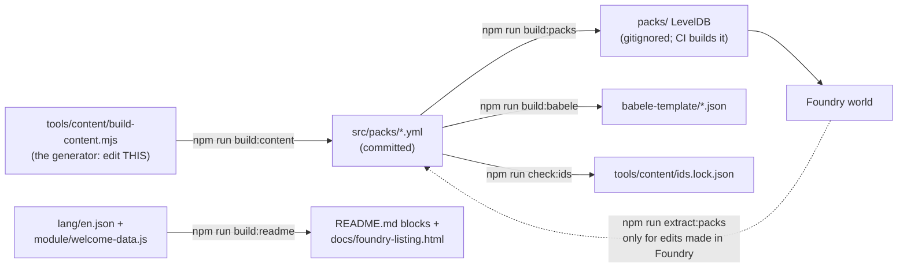

# Maintaining Base Knavery

For a developer picking up maintenance. It covers how the system works, how to support the people who
use it, how to change it, and what must never change. Every claim names its file, so you can check it
against the code. [CLAUDE.md](../CLAUDE.md) is the denser set of working notes this guide expands; the
code wins where they differ.

Base Knavery is a Foundry VTT **v14** game system (id `base-knavery`) for Knave, first and second
editions. Knave 1e plays out of the box. Knave 2e plays once the Game Master (GM) points the system at
their own copy of the book. It uses ApplicationV2 and TypeDataModel only, with no deprecated APIs.

**Contents:** [1. How it works](#1-how-it-works) · [2. How to support it](#2-how-to-support-it) ·
[3. How to modify it](#3-how-to-modify-it) · [4. Non-negotiables](#4-non-negotiables)

---

## 1. How it works

### 1.1 The repository

| Path | What it is |
| --- | --- |
| [system.json](../system.json) | The manifest: document types, `htmlFields`, packs, languages, install URLs |
| [module/](../module/) | All runtime code, plain ES modules, no bundler |
| [templates/](../templates/) | Handlebars: `actor/`, `item/`, `apps/`, `dashboard/`, `dialog/`, `chat/`, `combat/`, `parts/`, `print/` |
| [css/knavery.css](../css/knavery.css) | The one stylesheet |
| [lang/en.json](../lang/en.json) | Every interface string, under `KNAVERY.*` and `TYPES.*` |
| [src/packs/](../src/packs/) | Compendium sources as YAML. **Generated**, but committed |
| `packs/` | LevelDB compendia built from the YAML. Gitignored |
| [babele-template/](../babele-template/) | Generated translation template for the compendia |
| [tools/content/](../tools/content/) | Generators: packs, README blocks, Babele template |
| [tools/dev/](../tools/dev/) | The checks (`npm run check`) and the e2e probes |
| [tools/release.mjs](../tools/release.mjs), [tools/packs.mjs](../tools/packs.mjs) | The release command; YAML to LevelDB and back |
| `art/`, `icons/`, `fonts/`, `logo/` | Shipped assets (credits in [LICENSE.txt](../LICENSE.txt)) |
| `questing-beast/` | The maintainer's reference PDFs. Gitignored, never shipped, never quoted |

### 1.2 Start-up: the hooks in `knavery.js`

[module/knavery.js](../module/knavery.js) is the only entry in `system.json` `esmodules`. Everything
else is imported from it.

**`init`** (every client, before settings and documents exist), in order:

1. `CONFIG.KNAVERY` = everything [config.js](../module/config.js) exports.
2. `registerKeyIndexFields()` ([keys.js](../module/keys.js)): compendium indexes will carry the key flags.
3. `registerI18nHelpers()` ([i18n.js](../module/i18n.js)): `{{knPlural}}`, `{{knNum}}`, `<html lang>`.
4. Document classes (`KnaveryActor`, `KnaveryItem`, `KnaveryCombat`), the data models, the token bar
   attributes, `CONFIG.ui.combat = KnaveryCombatTracker`.
5. The two sheets, registered as default with `DocumentSheetConfig.registerSheet`.
6. `registerSettings()` ([settings.js](../module/settings.js)) and `registerClockSetting()` ([hazard.js](../module/hazard.js)).
7. `initSocket()` and every socket handler (see 1.8).
8. `registerRulebook()`, the B keybinding, the template partials.
9. `game.knavery`, the public API (see 1.3).

**Other hooks registered at load:** `renderChatMessageHTML` (binds the buttons of every card type),
`updateActor` / `updateCombatant` (morale breaking points), `createChatMessage` (the dashboard's request
log), `renderActorDirectory` / `renderItemDirectory` (Create Character, Create NPC, Create Item buttons),
`getSceneControlButtons` and `renderSceneControls` (the GM's dashboard button), `hotbarDrop` (weapon and
spellbook macros), `renderSettings` (the sidebar's welcome, rulebook, Guide and dashboard buttons).

**`ready`**, in order. The order matters:

| Step | Function | Who runs it | Why here |
| --- | --- | --- | --- |
| 1 | `loadKeyIndexes()` ([keys.js](../module/keys.js)) | every client | Lookups by key need the indexes first |
| 2 | `stampRules()` ([rules.js](../module/rules.js)) | the active GM only | The welcome says which edition the world plays |
| 3 | `maybeOpenWelcome()` ([welcome.js](../module/welcome.js)) | a GM who may change settings | |
| 4 | `updateCareerIcons()` ([character-generator.js](../module/character-generator.js)) | the active GM only | Not awaited |
| 5 | `stampTableKeys()` ([keys.js](../module/keys.js)) | the active GM only | Not awaited |

Steps 2, 4 and 5 catch their own errors and log `Base Knavery | … failed` to the console. There is no
classic version migration (no `migrateWorld`); the stamp and its top-up (1.6) do that job. All of it
waits for the **active GM**, so a world only ever opened by players is not stamped yet.

### 1.3 The `game.knavery` API

Defined at the end of the `init` hook in [knavery.js](../module/knavery.js). The shipped macros, the
probes and other modules use it; treat it as public.

| Group | Members |
| --- | --- |
| Windows | `openDashboard`, `openMarketplace`, `openMarketplaceManager`, `openCreateItem`, `openTableImporter`, `openWelcome`, `openRulebook`, `toggleRulebook`, `showRulebookPage`, `openSpellGenerator`, `buildRulebookTables` |
| Creation | `createCharacter`, `createCharacterInteractive`, `createNpc`, `createNpcInteractive` |
| Rolls | `rollCheck`, `rollSave`, `rollAttack`, `rollDieOfFate`, `rollItemMacro(actorId, itemId)` |
| Rules | `currentRules()`, `applyRules(edition)`, `offerRulesSwitch()` |
| Tables | `importRows`, `parseRows` |
| Table play | `endTurn`, `payWage`, `rally`, `toggle(key)` |
| Data | `config` (the same object as `CONFIG.KNAVERY`) |

### 1.4 Data models and documents

There is no `template.json`. [data-models.js](../module/data-models.js) defines one `TypeDataModel` per
sub-type and exports two maps the `init` hook installs:

| Document | Sub-types | Notes |
| --- | --- | --- |
| Actor | `character`, `npc` | An NPC's `role` field (`monster`, `npc`, `hireling`, `companion`) stands in for more actor types |
| Item | `item`, `weapon`, `armor`, `spellbook`, `career`, `transport` | All but `career` share `universal()`: description, kind, slots, quantity, cost, equipped, broken, treasure |

Derived values live in `prepareDerivedData` and are **not stored**: `ac`, `slotsMax`, `coinSlots`,
`canLevelUp`, `dead`, `unconscious`, each ability's `defense`, an item's `quality`. Several read rule
settings through [rules.js](../module/rules.js), inside `try/catch`, because a model can be prepared
before settings exist.

[documents/actor.js](../module/documents/actor.js) (`KnaveryActor`) holds the mechanics that need the
whole actor: `calcArmorPoints`, `calcSlotsUsed`, `slotLayout` (which slot each item, coin stack and wound
sits in), `addItems` (stacking), `applyDamage`, `rest`, `healWound`, and the change-log plumbing in the
`_preUpdate` / `_onUpdate` / descendant-document methods.
[documents/item.js](../module/documents/item.js) (`KnaveryItem`) sets default art and places a new
inventory item under the last row of its band (`_preCreateOperation`).

Two rules a newcomer to Foundry should know:

- **HTML fields are sanitized by the server from the manifest, not from the model.** Every `HTMLField`
  must also be listed in `system.json` `documentTypes.<Doc>.<type>.htmlFields`. `npm run check:fields`
  enforces it both ways.
- **`gmOnlyFields`** in `system.json` makes the server refuse a player's write (`gmNotes`).

### 1.5 Sheets and windows

| Window | Class | File |
| --- | --- | --- |
| Actor sheet (character and NPC) | `KnaveryActorSheet` | [sheets/actor-sheet.js](../module/sheets/actor-sheet.js) |
| Item sheet (all six types) | `KnaveryItemSheet` | [sheets/item-sheet.js](../module/sheets/item-sheet.js) |
| GM dashboard | `GmDashboard` | [gm-dashboard.js](../module/gm-dashboard.js) |
| Settings submenus | `SettingsGroupMenu` | [settings.js](../module/settings.js) |
| Welcome | `WelcomeWindow` | [welcome.js](../module/welcome.js) |
| Rulebook reader | `RulebookReader` | [rulebook.js](../module/rulebook.js) |
| Rulebook tables review | `RulebookTablesReview` | [rulebook-import.js](../module/rulebook-import.js) |
| Create Item | `CreateItemWindow` | [create-item.js](../module/create-item.js) |
| Combat tracker | `KnaveryCombatTracker` | [combat-tracker.js](../module/combat-tracker.js) |

Most short prompts (the roll prompt, the Attack window, Rest, pick-lists) are `DialogV2` calls built in
the feature module that needs them.

How an ApplicationV2 window here is put together, using the actor sheet as the example:

- `static DEFAULT_OPTIONS.actions` maps each `data-action="…"` in a template to a static private
  handler (`#onRest`, `#onAttack`…). Handlers are wrapped in guards: `owned` (the sheet is editable),
  `mayRandomize`, `careerGate`.
- `static PARTS` lists the templates. The sheet has two: `rail` and `form`. `_configureRenderParts`
  swaps the form template by actor type (`character-sheet.html` or `npc-sheet.html`).
- `static TABS` plus `_getTabsConfig` give the pages: `knave`, `inventory`, `growth`, `description`
  (an NPC has no Growth page). The pages are turned from a **thumb-tab rail** hung outside the window's
  edge: a render part ([templates/parts/tab-rail.html](../templates/parts/tab-rail.html)) placed by
  [sheets/tab-rail.js](../module/sheets/tab-rail.js). The dashboard uses the same rail; both frames wear
  the class `knavery-railed`.
- `_prepareContext` builds everything the template shows. `form.submitOnChange` is on, so the whole form
  is written on every change. For that reason **inputs show the stored value, not the Active-Effect
  value** (`effectAttrs` in the sheet explains why).
- `_prepareSubmitData` enforces the Char Gen Mode ability budget (`abilityBudget` in
  [level-up.js](../module/level-up.js)).

Who may edit what is in [edit-gates.js](../module/edit-gates.js): the sheet disables the inputs, and
`KnaveryActor._preUpdate` calls `stripLockedChanges` to drop the same changes from any other path. That
second check runs in the player's own browser. Only `gmNotes` is refused by the server.

A character's sheet is 440px wide and has no attacks column. Its Attack button opens one window
(`openAttack` in [rolls.js](../module/rolls.js)). NPC sheets keep 640px.

### 1.6 Rules and editions

This is the part most likely to confuse, so in full.

- **Each rule is its own world setting.** There is no "edition" setting.
- [config.js](../module/config.js) `RULES_PRESETS` gives every rule's value under `"1e"` and under
  `"2e"`. The rule keys are exactly the keys of `RULES_PRESETS["1e"]`.
- The registered **default** of each rule is its 1e value ([settings.js](../module/settings.js), `D[...]`).
- `currentRules()` ([rules.js](../module/rules.js)) reads every rule and returns `"1e"` if all match
  the 1e preset, `"2e"` if all match 2e, otherwise `"custom"`. `RULES_ALSO` lists extra values that
  still count as an edition (1e with treasure XP `gold`; 2e with `individual` initiative).
- `applyRules(edition)` writes a whole preset. The Configure Rules window's edition select does the same
  in the form, and shows which edition the rows currently match (`SettingsGroupMenu._onRender`).
- Feature code never asks for the edition. It asks about one rule through the helpers in `rules.js`:
  `usesWounds()`, `usesCareers()`, `usesQuality()`, `usesPrices1e()`, `coinsPerSlot()`, `spellRule()`…
  The one exception is `abilityHint`, which picks the ability taglines by `currentRules()`.

The rules today: `creation-abilities`, `starting-kit`, `show-alignment`, `show-background`,
`first-level-hp`, `level-hp-rule`, `death-rule`, `healing-rule`, `spell-rule`, `spell-list`,
`knave1e-xp`, `initiative-rule`, `attack-rule`, `price-list`, `coins-per-slot`, `treasure-xp`,
`advantage-mode`.

**The stamp** (`stampRules`, at `ready`, active GM only) decides what an existing world plays:

| World at first GM login on 0.2.0 or later | What happens | `rules-stamp` |
| --- | --- | --- |
| New: no stored system settings, no actors, items or journals (`isExistingWorld`) | Nothing is written; it plays the 1e defaults | `"1e"` |
| Existing | Every rule the world never stored is written with its 2e value | `"2e"` |
| Already stamped | `topUpRules` only | unchanged |

**The top-up** (`topUpRules`) handles rules added in a later release. The hidden setting `rules-keys`
lists the rules the world has been given. For each new one, the world gets the value of the edition its
known rules all match (`editionForNewRules`), falling back to its stamp. So a 2e world stays 2e when a
release adds a rule, although the new rule's default is 1e.

`offerRulesSwitch()` asks the GM whether to move to 2e after a table build from the 2e book. A switch
never changes an existing character.

### 1.7 Identity by key, and table lookup

The system finds its tables, items and Guide pages by **English name**: `"Careers"`, `"Market: Weapons"`
(`TABLES` in [config.js](../module/config.js)). So that a translation can rename them,
[keys.js](../module/keys.js) adds a second identity:

- Every shipped document carries `flags.base-knavery.key`, the slug of its English name (`keyOf`).
- `findByKey(docs, englishName)` tries the key, then the name, then the language file's
  `KNAVERY.TableName.<key>`. Callers always pass the English name.
- Items whose name drives a rule carry `flags.base-knavery.kind` (`rations`, `torch`, `candle`,
  `lantern`, `arrows`). `isKind` reads the flag, then Babele's original name, then the language file's
  `KNAVERY.ItemWords.<kind>`, then the English pattern.
- `stampTableKeys` gives each world table its own name's key at the GM's login, so the GM may rename it.

[compendium.js](../module/compendium.js) builds table lookup on that:

- **`findTable(name)`: the world wins.** A world RollTable with the key or name is used first, then
  the compendia (system packs before module packs). This is how a GM overrides any shipped table.
- **Shipped Knave 2e tables are shells**: the right name and dice, and one row flagged
  `flags.base-knavery.placeholder`. `realResults` drops placeholders, and `drawFrom` warns
  "table is empty" instead of drawing one.
- `drawFrom` rolls for itself and never calls `RollTable#draw`: a compendium table is locked, and a draw
  would try to mark the result drawn.
- `spellTableName()` picks the spell list: the world's own Spells table once it has rows, else Knave
  1e's shipped spells; the rule `spell-list` can force 1e.
- Marketplace aisles are tables named `Market: <Aisle>` (2e) or `Market 1e: <Aisle>`, also flagged
  `market` and `aisle` (`inTableGroup`, `findTablesByPrefix`).

### 1.8 The socket and the GM relay

[socket.js](../module/socket.js) is one channel, `system.base-knavery`, dispatching on `msg.action`:
`onSocket(action, fn)` registers, `emit(action, payload, {recipients})` sends. `system.json` has
`"socket": true`.

| Action | Module | Purpose |
| --- | --- | --- |
| `applyDamage` | [damage.js](../module/damage.js) | A player applies damage to an actor they do not own |
| `requestRoll` | [gm-dashboard.js](../module/gm-dashboard.js) | The GM asks a player for a check, save or generated spell |
| `generatePC`, `pcGenerated` | [character-generator.js](../module/character-generator.js) | A player without create permission has the GM's client create their character |
| `offerAccept`, `offerDecline`, `offerRelease`, `offerDone`, `offerFail`, `offerRefused` | [item-offer.js](../module/item-offer.js) | Giving an item, peer to peer; no GM needed |
| `showRulebookPage` | [rulebook.js](../module/rulebook.js) | The GM shows players a page of the PDF |

The rules every handler follows (the header of `socket.js`): trust only the `senderId` Foundry attaches;
rebuild the payload field by field; a GM-only handler checks `game.user.isActiveGM` so exactly one client
acts.

`handleApplyDamage` is the model. It acts only if the sender is the **author** of the chat card named,
the amount **equals** the card's total, and each target is one the sender can see. Anything else is
dropped silently.

### 1.9 Settings

[settings.js](../module/settings.js) registers every setting with `config: false` and shows them through
six submenus built by one class (`SettingsGroupMenu`, one subclass per entry of `SETTING_GROUPS`):
General, Creation, Inventory, Rules, Rulebook, Printing.

- A group's `keys` array is the order the GM sees. A key starting with `#` is a section heading
  (`KNAVERY.Settings.Section.<name>`).
- `reg(key, {label, …})` derives the name and hint keys: `KNAVERY.Settings.<label>` and
  `…<label>Hint`. A missing hint key simply shows no hint.
- A setting that changes derived data calls `reprepareActors()` (which uses `actor.reset()`) and
  `rerenderActorSheets()` in its `onChange`.
- Hidden state settings: `rules-stamp`, `rules-keys`, `welcome-shown-version`, `market-hidden-aisles`,
  `market-hidden-aisles-1e`, `custom-portrait-list`, `portrait-galleries`, `random-portrait-source`.
- `knave1e-starting-gear` is retired but still registered, so the stamp can read it in an old world.

### 1.10 The GM dashboard

[gm-dashboard.js](../module/gm-dashboard.js), one ApplicationV2 with a render part per page. Opened from
the big button atop the left toolbar (`#knavery-dashboard-hud`), the Actors sidebar, the Settings sidebar
or `game.knavery.openDashboard()`.

| Tab id | Label | Template | Logic mostly in |
| --- | --- | --- | --- |
| `requests` | Requests | [requests.html](../templates/dashboard/requests.html) | `gm-dashboard.js`, [spell-generator.js](../module/spell-generator.js) |
| `damage` | Combat | [damage.html](../templates/dashboard/damage.html) | [damage.js](../module/damage.js), [initiative.js](../module/initiative.js) |
| `time` | Time | [time.html](../templates/dashboard/time.html) | [hazard.js](../module/hazard.js), [hirelings.js](../module/hirelings.js) |
| `party` | Party | [party.html](../templates/dashboard/party.html) | `partyRows` in `gm-dashboard.js` |
| `dice` | Dice | [dice.html](../templates/dashboard/dice.html) | [rolls.js](../module/rolls.js) |
| `xp` | XP | [xp.html](../templates/dashboard/xp.html) | `xpAwards`, [treasure.js](../module/treasure.js) |
| `market` | Marketplace | [market.html](../templates/dashboard/market.html) | [marketplace.js](../module/marketplace.js) (`MARKET_ACTIONS`, `marketPageContext`) |
| `tools` | Toggles | [tools.html](../templates/dashboard/tools.html) | `setToggle`, [art.js](../module/art.js) `GALLERIES` |
| `tables` | Tables | [tables.html](../templates/dashboard/tables.html) | [table-importer.js](../module/table-importer.js), [rulebook.js](../module/rulebook.js) |

The tab ids are older than some labels (`damage` is the Combat page, `tools` is Toggles). Keep the ids.

Each feature module opens with a header comment saying what it does and which rulings it follows;
[CLAUDE.md](../CLAUDE.md) ("Layout") lists them all in one place.

### 1.11 The content pipeline



- [build-content.mjs](../tools/content/build-content.mjs) writes every pack: `gear`, `gear-1e`,
  `careers`, `marketplace`, `tables`, `monsters`, `macros`, `guide`. It deletes and rewrites each
  `src/packs/<pack>/` folder.
- **Ids are a hash of the pack and the English name** (`id()`), so regenerating never changes them and
  renaming a document changes its id. Ids are frozen by `npm run check:ids`.
- Each document's `_stats.coreVersion` is `system.json` `compatibility.minimum`, the **oldest**
  supported build; a newer one makes older builds log a migration error per document.
- Every top-level document carries `folder: null`, `sort: 0`, `ownership: {default: 0}` (`add()`), and
  the Guide's HTML is trimmed. Without both, a world launch rewrites the pack and the build guard
  reports drift.
- [packs.mjs](../tools/packs.mjs) `build` deletes and recompiles `packs/`. Its **guard** refuses when
  the built packs differ from the last sync marker (`.pack-sync.json`), meaning someone edited a
  compendium inside Foundry. Run `npm run extract:packs` first, or pass `-- --force` if you are sure.
  CI always passes `--force`.
- The pack list comes from `system.json`, so a new pack is added there and in the generator.

### 1.12 Localization

- **Interface:** [lang/en.json](../lang/en.json). Plurals are sections of `Intl.PluralRules` forms,
  used only through `P(key, n)` or `{{knPlural}}` ([i18n.js](../module/i18n.js)); `listOf` and `num`
  format lists and numbers in the user's language.
- **Content:** Babele. [babele-template/](../babele-template/) is generated from `src/packs/` by
  [build-babele-template.mjs](../tools/content/build-babele-template.mjs), keyed by English names.
  Knave 1e table rows keep their English in `flags.base-knavery.en`, so the 1e starting-gear roll still
  finds the right item under a translation.
- **Why it holds together:** identity by key (1.7) and frozen ids (1.11).
- Only English ships today. [TRANSLATING.md](../TRANSLATING.md) is the translator's guide.

---

## 2. How to support it

### 2.1 How people install and update

`system.json` carries both URLs:

- `manifest`: `…/releases/latest/download/system.json`. This is what a user pastes into Foundry's
  Install System dialog, and what Foundry polls for updates.
- `download`: in the repository it also points at `latest`. The release workflow rewrites it, in the
  released copy only, to that version's own `system.zip`.

Supported Foundry builds are `compatibility.minimum` to `verified` in `system.json`. The release zip
holds `README.md`, `LICENSE.txt`, `CHANGELOG.md`, `system.json`, `art/`, `css/`, `fonts/`, `icons/`,
`lang/`, `logo/`, `module/`, `packs/`, `templates/`
([.github/workflows/main.yml](../.github/workflows/main.yml)). A new top-level folder the system needs
at runtime must be added to that `zip` line.

### 2.2 "Which edition is my world playing?"

Ask the user to run this in the browser console (F12), as GM:

```js
game.knavery.currentRules()                                   // "1e", "2e" or "custom"
game.settings.get("base-knavery", "rules-stamp")              // "1e", "2e" or "" (never stamped)
game.settings.get("base-knavery", "rules-keys")               // the rules this world has been given
Object.fromEntries(Object.keys(CONFIG.KNAVERY.RULES_PRESETS["1e"])
  .map((k) => [k, game.settings.get("base-knavery", k)]))     // every rule's value
game.settings.storage.get("world").filter((s) => s.key.startsWith("base-knavery."))  // what is stored
```

`"custom"` only means at least one rule differs from both presets. Configure Settings, Base Knavery,
**Configure Rules** shows the same answer in its edition select; choosing an edition there and saving
puts every rule back.

### 2.3 The welcome window, the rulebook reader and the tables

- **Welcome** ([welcome.js](../module/welcome.js)): what the system is, the disclaimer, which edition
  the world plays, where to buy both books. It opens at a GM's login unless `welcome-on-start` is off
  (Configure General, or the tick box in the window). Anyone reopens it from the Settings sidebar.
- **Rulebook reader** ([rulebook.js](../module/rulebook.js)): shows the GM's own PDF in the pdf.js
  viewer Foundry already bundles. The system stores **only a path** (setting `rulebook-pdf`) and a page
  offset. The PDF must be in the server's user data, since players are shown pages from it; "Choose
  from this computer" uploads it there (`pickLocalRulebook`, folder `RULEBOOK_DIR`). Players read it
  only if `rulebook-for-players` is on. The B key toggles it.
- **Page numbers** are printed pages. The PDF index is the printed page plus `rulebook-page-offset`
  (default from `RULEBOOK.pageOffset` in [config.js](../module/config.js)). A PDF with another page
  count than `RULEBOOK.pdfPages` warns once.
- **Build tables from the book** ([rulebook-import.js](../module/rulebook-import.js)): reads the PDF in
  the GM's browser, shows a review, and writes world RollTables only when the GM presses Build. Each
  built table carries `flags.base-knavery.rulebook.hash`. A rebuild replaces a table only if that flag
  is present and the rows still match it; a table the GM edited, imported or made by hand is kept and
  reported. The Spells table also writes a spellbook and scroll per spell into the world compendium
  `world.rulebook-spells`.
- **Table importer** ([table-importer.js](../module/table-importer.js)): paste rows, get a world table
  of the same name as the shell. **Use as** makes a table under any name stand for one of the system's.

### 2.4 Common reports and where to look

| The user says | Likely cause | Look at |
| --- | --- | --- |
| "Table X is empty" warning; a creation step was skipped | The table is still a shell | Import it, or build from the book. `drawFrom` in [compendium.js](../module/compendium.js) |
| New characters have no careers or coins | The world plays the 1e starting kit | `starting-kit`; 2.2 |
| My imported table is ignored | Its name or key does not match | `game.tables.getName("…")?.flags["base-knavery"]`; the importer's **Use as** |
| A rebuild did not replace a table | The GM edited it, or it was not built by the builder | `flags.base-knavery.rulebook.hash`; `tableStatus` in [rulebook-import.js](../module/rulebook-import.js) |
| A player's damage button did nothing | No GM online (a warning shows), or the relay's checks failed | `handleApplyDamage` in [damage.js](../module/damage.js) |
| A player cannot change abilities, level or XP, or an edit bounces back | Char Gen Mode is off, the GM's switches are, or the ability budget | [edit-gates.js](../module/edit-gates.js); `abilityBudget` in [level-up.js](../module/level-up.js) |
| A player cannot create a character | `allow-player-generate` is off, or no GM is online to create it for them | `createCharacterInteractive`, `registerCreationSocket` |
| The rulebook opens on the wrong page | Page offset, or a different printing of the PDF | `rulebook-page-offset`; `RULEBOOK` in [config.js](../module/config.js) |

### 2.5 Diagnosing

- **Console:** every system log line starts `Base Knavery |`. Socket handler errors are caught and
  logged as `Base Knavery | socket <action> failed`.
- **Flags**, all under `flags.base-knavery`:

  | On | Flags |
  | --- | --- |
  | RollTable | `key`, `market`, `aisle`, `rulebook` (`hash`), `imported` |
  | TableResult | `placeholder`, `price`, `service`, `en` |
  | Item | `key`, `kind`, `fromCareer`, `rulebookSpell`, `generated` |
  | Actor | `autoDead`, `autoUnconscious`, `wornBy` |
  | ChatMessage | `damage`, `attack`, `damageApplied`, `hazard`, `hazardApplied`, `changeLog`, `levelUp`, `xpAward` |
  | Combat | `groupInitiative`, `leaders`, `breaking`, `rallied` |
  | Combatant | `acted`, `autoDefeated` |

- **Update options** that change behaviour: `knNoLog` (no change-log card), `knLogAction` (name the
  action on the card), `knLevelUp` and `knCreation` (write through the edit gates).
- **A user's world** is the best evidence. Ask for the Foundry build, the system version, the result of
  2.2, and the console output.

### 2.6 Releasing

Work happens on `dev`; `master` is the released state. The public GitHub repository is a push mirror of
a private origin, so **never tag or create a release on GitHub directly**: the mirror prunes refs that
exist only there.

1. Write a `## X.Y.Z` section at the top of [CHANGELOG.md](../CHANGELOG.md), in words a GM understands.
   Commit it.
2. Merge `dev` into `master`.
3. On `master`: `npm run release X.Y.Z`. Preview first with `npm run release X.Y.Z -- --dry-run`.
4. Wait for the tag to reach GitHub. The **Release Creation** workflow builds the packs, runs
   `npm run check` and `npm run lint`, and attaches `system.json` and `system.zip`, with the release
   body read from the tag.
5. Check the manifest URL answers, then merge `master` back into `dev`.
6. Retake the Foundry listing's welcome picture, so its version line shows the new release: run the
   `listing` probe ([e2e-listing.mjs](../tools/dev/e2e-listing.mjs)) at the release commit and replace
   [docs/listing/welcome.png](listing/welcome.png) **under the same name**, because the submitted
   listing links that address. Only that picture.

What [release.mjs](../tools/release.mjs) does, and refuses:

- Refuses unless on `master`, with a clean tree, with no such tag locally or on origin, and with a
  non-empty `## X.Y.Z` section in the changelog.
- Bumps `version` in `system.json`, runs `npm run build:content` (the packs carry the system version in
  `_stats`), commits `Release X.Y.Z`, creates an annotated tag whose body is the changelog section, and
  pushes branch and tag in one atomic push.
- If `system.json` already reads the version (a failed earlier run), it skips the bump and tags `HEAD`.

Before a release, run the probes on every supported Foundry build, not only the newest (3.6).

---

## 3. How to modify it

### 3.1 Setup

```
npm install
npm run build:packs     # packs/ is gitignored: build it before the first launch
```

Node 24 is what CI uses. To run the system, make the repository available to a Foundry v14 server as
`Data/systems/base-knavery` (a clone or a link) and create a world. There is no build step for the
JavaScript, and `system.json` `flags.hotReload` reloads CSS, templates and language files.

### 3.2 The `npm run` scripts

| Script | What it does |
| --- | --- |
| `lint` | ESLint over `module/` ([.eslintrc.json](../.eslintrc.json): `eslint:recommended`, `prefer-const`, `no-return-await`) |
| `build:content` | Generator to `src/packs/` |
| `build:packs` / `extract:packs` | `src/packs/` to `packs/`, and back |
| `build:readme` | README blocks and `docs/foundry-listing.html` |
| `build:babele` | `babele-template/` |
| `check` | All six checks below |
| `dev:*` | The e2e probes (3.6) |
| `release` | 2.6 |

What each check enforces:

| Check | File | Fails when |
| --- | --- | --- |
| `check:manifest` | [manifest-check.mjs](../tools/dev/manifest-check.mjs) | `system.json` names a file that does not exist, a pack has no sources, ids disagree |
| `check:fields` | [field-audit.mjs](../tools/dev/field-audit.mjs) | An `HTMLField` in the data models is missing from `htmlFields`, or the reverse; an `HTMLField` sits inside an array or object field; the sub-types disagree with `documentTypes` |
| `check:i18n` | [i18n-check.mjs](../tools/dev/i18n-check.mjs) | A `KNAVERY.*` key used in code or templates is missing; a runtime-built key (`KNAVERY.Ability.${k}`) lacks a member; a `format` call omits a `{placeholder}`; a plural key is misused; the disclaimer differs between `en.json`, README and LICENSE; a translation has a key, placeholder or tag English lacks |
| `check:readme` | [build-readme.mjs](../tools/content/build-readme.mjs) `--check` | The generated README blocks or listing are out of date |
| `check:ids` | [ids-check.mjs](../tools/dev/ids-check.mjs) | An id in `ids.lock.json` is gone from `src/packs/`. New ids pass; `npm run check:ids -- --update` freezes them |
| `check:babele` | [build-babele-template.mjs](../tools/content/build-babele-template.mjs) `--check` | `babele-template/` is out of date |

Run `npm run check` and `npm run lint` before every push. CI runs both on a release.

### 3.3 Generated files: edit the source

| Never edit | Edit instead | Then run |
| --- | --- | --- |
| `src/packs/**/*.yml` | [tools/content/build-content.mjs](../tools/content/build-content.mjs) | `npm run build:content` |
| `babele-template/*.json` | the generator | `npm run build:babele` |
| README between `<!-- welcome:… -->` and `<!-- licensing:… -->`; `docs/foundry-listing.html` | [lang/en.json](../lang/en.json) (`KNAVERY.Welcome`, the disclaimer) and [module/welcome-data.js](../module/welcome-data.js) | `npm run build:readme` |
| `packs/` | nothing; it is build output | `npm run build:packs` |

The rest of the README is hand-written. Keep it a short feature list; detail belongs in the Guide.

### 3.4 Recipes

**Add a rule setting**

1. [config.js](../module/config.js): add the key to **both** `RULES_PRESETS["1e"]` and `["2e"]`. If
   another value should still read as an edition, add it to `RULES_ALSO`. Do not touch
   `CORE_RULE_KEYS`: it is the historical list of 0.2.0's first rules.
2. [settings.js](../module/settings.js): `reg("my-rule", { label, type, choices, default: D["my-rule"], onChange })`,
   and add the key to the `hacks` group's `keys` under the right `#section`.
3. [lang/en.json](../lang/en.json): `KNAVERY.Settings.<label>`, optionally `<label>Hint`, and one key
   per choice.
4. [rules.js](../module/rules.js): export a small accessor (`usesX()`), and use it in the feature code.
5. Nothing to do for existing worlds: `topUpRules` sees a key missing from the world's `rules-keys` and
   writes the value of the edition the world plays. Check it by loading an old 2e world.
6. Describe the rule on the Guide's rules page (in the generator), and in the changelog.

**Add an item, monster, macro or table to a compendium**

1. Add it in [build-content.mjs](../tools/content/build-content.mjs) with the helper its neighbours use
   (`w`, `a`, `g`, `t` for 2e gear; `w1`, `a1`, `g1`, `t1` for 1e gear; `monster`; `macro`; `shell` for
   a Knave 2e table; `knave1e` for a filled Knave 1e table, with its credit).
2. `npm run build:content`, then `npm run check:ids -- --update`, `npm run build:babele`,
   `npm run build:packs`.
3. If code looks the table up, add its name to `TABLES` in [config.js](../module/config.js). If it comes
   from the 2e book, add its place to [rulebook-catalogue.js](../module/rulebook-catalogue.js) (names,
   pages and layout only) and its page to `RULEBOOK.pages`.
4. **Never rename an existing document**: its id is hashed from its name, and `check:ids` will fail.
5. Read section 4 before adding any text.

**Add a field to a sheet**

1. [data-models.js](../module/data-models.js): add it to the schema with the field factories (`str`,
   `int`, `bool`, `html`). For an `html()` field, list it in `system.json` `htmlFields` too.
2. The template ([character-sheet.html](../templates/actor/character-sheet.html),
   [npc-sheet.html](../templates/actor/npc-sheet.html) or [item-sheet.html](../templates/item/item-sheet.html)):
   an input named `system.<path>`. The form submits on change; no handler is needed.
3. Anything computed for display goes in the sheet's `_prepareContext`. A button needs a
   `data-action` and an entry in `DEFAULT_OPTIONS.actions`.
4. Labels and tooltips in `lang/en.json`.
5. Consider: the change log's `AUDIT_LABELS` ([change-log.js](../module/change-log.js)); whether players
   may edit it ([edit-gates.js](../module/edit-gates.js)); the printed sheet
   ([print.js](../module/print.js), which must stay one page); the Babele mapping if translators need it.

**Add a dashboard page**

1. A template in [templates/dashboard/](../templates/dashboard/) whose root is
   `<section class="tab {{tab.cssClass}}" data-tab="<id>" data-group="primary">`.
2. In [gm-dashboard.js](../module/gm-dashboard.js): an entry in `PARTS`, one in `TABS.primary.tabs`
   (id, icon, label key), its data in `_prepareContext` or `_preparePartContext`, its buttons in
   `DEFAULT_OPTIONS.actions`.
3. `KNAVERY.Dashboard.Tab<Name>` in `lang/en.json`.
4. The rail's Guide button: add the page to the `anchors` map in the `openGuide` action, and a matching
   heading on the Guide's dashboard page in the generator.
5. Re-render only your part when data changes (`render({ parts: ["<id>"] })`), as `treasure-xp` does.

**Add a translation**

1. Add `lang/<code>.json` and its entry in `system.json` `languages`.
2. `npm run check:i18n` prints its coverage; `node tools/dev/i18n-check.mjs --status` lists missing keys.
3. Credit the translator. Translations are by people; see section 4 and [TRANSLATING.md](../TRANSLATING.md).

### 3.5 Coding conventions

- **No deprecated APIs.** ApplicationV2, `DialogV2`, TypeDataModel, namespaced classes
  (`foundry.applications…`). The code should move to later Foundry versions unchanged.
- **Numbers live in [config.js](../module/config.js)**, never inline, and never with rules prose.
- **Colours only through `--kn-*` tokens**, defined once in the palette block at the top of
  [knavery.css](../css/knavery.css), with a dark block beside it. Windows follow the viewer's colour
  scheme. Base Knavery's own rules are the last section of the file.
- **Every user-facing string goes through `lang/en.json`.** Use `P()` for anything counted.
- **"Game Master"** in titles, labels and the first mention in a standalone message or Guide page;
  **"GM"** after that and in hints, tooltips and placeholders.
- **Notifications that carry a name:** pass the key and `{ format: { name } }`, so core escapes it.
  Plain ones pass `{ localize: true }`.
- **Dialog content ids** carry a random prefix (`idp = foundry.utils.randomID()`), because two dialogs
  can be open at once and a `<label for>` resolves to the first match in the page.
- **Escape** anything interpolated into HTML with `foundry.utils.escapeHTML`.
- **Re-preparing actors:** `actor.reset()` (`reprepareActors`), never `prepareData()` alone, which
  applies Active Effects a second time.
- **Automatic updates** pass `knNoLog` (or `knLogAction`) so they do not post change-log cards.
- **GM-only side effects** check `game.user.isActiveGM`, so one client acts.
- **Lists of compendium content** use pack indexes, not loaded documents.
- A fix to one window's layout or behaviour usually applies to every system window; check the others.

### 3.6 The e2e probes

The probes in [tools/dev/](../tools/dev/) drive a live Foundry server through Playwright, as the GM and
two players. They expect a world with a GM and two players named Alice and Bob, and they create and
delete their own "Probe …" documents. [lib.mjs](../tools/dev/lib.mjs) holds the helpers and reads the
environment: `FOUNDRY_URL` (default `http://localhost:30000`), `FOUNDRY_GM`, `MB_SHOTS` (where
screenshots go; default `tools/dev/out/`), `MB_TIME_SCALE` (stretches every timeout). Wrap anything that
changes world settings in `withSettings`, which restores them even when the probe throws.

| Script | Probe | Covers |
| --- | --- | --- |
| `dev:smoke` | [e2e-smoke.mjs](../tools/dev/e2e-smoke.mjs) | Core mechanics through the API as the GM; screenshots of the main windows |
| `dev:players` | [e2e-players.mjs](../tools/dev/e2e-players.mjs) | Three browsers: a requested save, an item offer, the change log, print, creation through the GM, showing a rulebook page |
| `dev:screens` | [e2e-screens.mjs](../tools/dev/e2e-screens.mjs) | Every main window in both colour schemes; careers |
| `dev:fixes` | [e2e-fixes.mjs](../tools/dev/e2e-fixes.mjs) | Regression checks for the first code review's findings |
| `dev:chargen` | [e2e-chargen.mjs](../tools/dev/e2e-chargen.mjs) | The largest: edit gates, level-up, HP rules, creation, the Attack window, rest, hazards, morale, wages, the Knave 1e rules, treasure, the dashboard. New feature checks usually go here as a numbered part |
| `dev:print` | [e2e-print.mjs](../tools/dev/e2e-print.mjs) | Prints four knaves to real PDFs on Letter and A4 and asserts one page each |
| `dev:fresh` | [e2e-fresh.mjs](../tools/dev/e2e-fresh.mjs) | A world no GM has opened: the 1e stamp, then a table build from a real PDF and the switch to 2e. Needs its own fresh world with the PDF staged |
| `dev:i18n` | [e2e-i18n.mjs](../tools/dev/e2e-i18n.mjs) | A marked pseudo-language: finds English left outside the language file and clipped labels; plurals |
| `dev:listing` | [e2e-listing.mjs](../tools/dev/e2e-listing.mjs) | The three pictures on the Foundry package listing |

The maintainer runs these on a private test fleet, against each supported Foundry build; that setup is
in the maintainer's own runbook, not in this repository. Day to day the newest build is enough; all
supported builds must pass before a release.

[rulebook-tables-check.mjs](../tools/dev/rulebook-tables-check.mjs) checks the table catalogue against a
local copy of the PDF, in Node. It prints row counts only. Its `--show` flag prints book text to the
terminal: **never commit that output.**

### 3.7 Foundry v14 gotchas met so far

- An AppV2 window with `height: "auto"` is capped at the screen height and its `.window-content` hides
  overflow, so a long window clips its rows and footer. Give the long part
  `flex: 1 1 auto; min-height: 0; overflow: auto`.
- `FilePathField({categories: []})` throws at init. Use a String setting with `filePicker: "folder"`.
- `DialogV2` resolves a nullish button result to the action name. Return `false`, not `null`, for "no
  choice" (`pickFromList` in [compendium.js](../module/compendium.js)).
- `StringField` trims. Pack text must survive a world launch byte for byte, or the pack guard reports
  drift; the generator trims the Guide's HTML.
- Pack documents need `folder`, `sort` and `ownership` defaults, and a `coreVersion` no newer than the
  oldest supported build (1.11).
- `RollTable#draw` on a locked compendium table tries to write to it; `drawFrom` rolls for itself.
- `window.open` for printing must happen synchronously inside the click, before any `await`, or a
  popup blocker stops it.
- The rulebook window never re-renders to turn a page: that would reload the iframe. It drives the
  viewer's `PDFViewerApplication` instead.

---

## 4. Non-negotiables

### 4.1 Content and licensing

The repository is public. These rules are what make it legal to publish. The full text is in
[CLAUDE.md](../CLAUDE.md) ("Content policy") and [LICENSE.txt](../LICENSE.txt).

- **No Knave 2e text or art, anywhere**: not in code, packs, language files, the Guide, tests, commit
  messages or this document. Its licence allows mechanics and numbers only. Page references ("p59") and
  numbers are fine.
- **No Dungeon Crawl Classics text, ever.**
- **Knave first edition is CC BY 4.0.** Its rules, traits, tables, gear and spells ship, and every use
  carries the credit: in each table, in `LICENSE.txt`, in the README and in the welcome window.
  Anything further taken from 1e needs the same credit.
- **Knave 2e tables ship as shells** (name, dice, one placeholder row). The GM fills them.
- **The GM's own PDF stays the GM's.** The reader stores a path. The table builder runs only in the
  GM's browser and writes only into their world. The repository holds table names, pages and layout
  ([rulebook-catalogue.js](../module/rulebook-catalogue.js)), never rows.
- **The bestiary is statistics only**, under generic or SRD names. Two well-known protected monsters are
  left out on purpose; do not add them.
- **Logos:** only the "Made for Knave" logos in `logo/` ship. Never the Knave 2e or publisher logos.
- **Disclaimers:** `KNAVERY.Disclaimer` must read the same in `lang/en.json`, `LICENSE.txt` and
  `README.md` (`check:i18n` enforces it), and the welcome window shows it verbatim.
  `KNAVERY.DisclaimerShort` is the sheet footer's. Do not reword either without the owner.
- **Level titles, hints and the Guide are this project's own writing.** The ability taglines are lists
  of mechanics, in two fixed sets (1e and 2e).
- **Translations:** people's own translations of what the system ships, crediting Ben Milton for Knave
  1e. Published translations of Knave 1e are not shipped: their translators hold their rights. No Knave
  2e text in any language. A machine-made draft must be disclosed in the welcome's AI disclosure.
- **Art** is human-made and credited; the welcome says so.

When unsure whether some text may ship, it may not until the owner says so.

### 4.2 Deliberate behaviour: do not "fix" these

These are the owner's rulings. They look like bugs or departures from the books and are not. The full
list, with dates, is in [CLAUDE.md](../CLAUDE.md) ("House rulings on the rules").

| Behaviour | Where |
| --- | --- |
| A new world plays Knave 1e; an existing one keeps 2e; switching never changes a character | [rules.js](../module/rules.js) |
| A wounded slot's item is **Unusable**, not dropped. Wounds fill from the bottom: empty slots, then coins, then the lowest item | `slotLayout` in [actor.js](../module/documents/actor.js) |
| Every character has an improvised attack: d4 with STR, no item | `IMPROVISED_ID` in [rolls.js](../module/rolls.js) |
| Hazard results (fatigue, burn, depletion) apply only when the GM clicks the card's button | [hazard.js](../module/hazard.js) |
| Char Gen Mode holds every sheet, the GM's too, to the level's ability points | `abilityBudget`, `_prepareSubmitData` |
| Players create random characters only; the blank sheet is the GM's | [character-generator.js](../module/character-generator.js) |
| Alignment and Background are hidden unless switched on, show on the Knave page, and hidden ones are not rolled | `traitShown` in [settings.js](../module/settings.js) |
| Backstory has a 35-word counter, never a limit | `BACKSTORY_WORDS` |
| An item sells for half its price, treasure for full value; repair under 2e attacks is free | [treasure.js](../module/treasure.js), [quality.js](../module/quality.js) |
| Knave 1e: 0 HP is unconscious, -1 is dead (so `hp.value` may be -1); the Direct damage button is hidden | [data-models.js](../module/data-models.js) |
| Knave 1e: a hit must **exceed** the defense; a natural 20's armor wear is chosen by the target's owner; 0 quality is Broken and kept | [rolls.js](../module/rolls.js), [quality.js](../module/quality.js) |
| Knave 1e: no first-casualty morale card and no Rally; a leader's fall is a breaking point in both editions | [hirelings.js](../module/hirelings.js) |
| A power attack is ticked in the Attack window; there is no card button | [rolls.js](../module/rolls.js) |
| A rest eats one ration; HP returns only after sleep and a meal | `rest` in [actor.js](../module/documents/actor.js) |
| Rations and torches per slot are settings; candles and arrows keep the items' own bundles | [settings.js](../module/settings.js) |
| Knave 2e gives two careers; there is no failed-career rule. The GM may add a third | [character-generator.js](../module/character-generator.js) |
| A shell Names table falls back to the system's own name list | [names.js](../module/names.js) |
| The welcome opens at every GM login until switched off | [welcome.js](../module/welcome.js) |
| A 1e world with treasure XP `gold`, or a 2e world on `individual` initiative, still reads as its edition | `RULES_ALSO` in [config.js](../module/config.js) |
| Lodging & Meals and Buildings aisles are hidden by default in the 1e market | `market-hidden-aisles-1e` |

If a report contradicts one of these, the answer is usually a setting or an explanation, not a patch.
If you believe a ruling is wrong, raise it with the owner; do not change it in passing.
